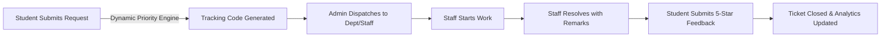

# CampusFlow — Smart College Service & Issue Management System

> **Enterprise Java Web Application with Oracle Database Persistence**  
> *Developed strictly using pure Java EE (Servlets, JSP, JDBC), Oracle Database (10g/11g/19c XE), Apache Tomcat 9, Vanilla JavaScript, and Modern CSS3.*

[]()
[-brightgreen.svg)]()
[]()
[]()

---

## 1. Project Overview

**CampusFlow** digitizes and streamlines how universities receive, prioritize, assign, track, and resolve campus service requests across physical infrastructure, IT, electrical systems, plumbing, and academic facilities.

### Core Value Drivers:
- **For Students**: Structured self-service request submission with automated unique tracking codes (`CF-2026-xxxxx`), interactive priority preview, real-time audit timelines, and post-resolution 5-star feedback.
- **For Staff**: An organized queue of assigned work, real-time status transitions with mandatory resolution remarks, and personal workload analytics.
- **For Administrators**: Central operational governance, multi-attribute ticket search, dynamic department/staff assignment, priority override with mandatory justification, user directory management, and live SVG analytics.

---

## 2. Technology Stack & Strict Architectural Restrictions

In strict compliance with requirements, CampusFlow uses **zero third-party frameworks** or external libraries:

| Layer | Permitted Technology | Prohibited & Excluded Technologies |
| :--- | :--- | :--- |
| **Presentation** | HTML5, Modern CSS3 (CSS Variables, Flexbox, Grid), Vanilla JS (ES6+) | *No React, Vue, Angular, Bootstrap, Tailwind, jQuery* |
| **Data Visualizations** | Native SVG Charting Engine (`charts.js`) | *No Chart.js, D3.js, Google Charts* |
| **View Templates** | JavaServer Pages 2.3 (JSP with shared fragments) | *No Thymeleaf, Freemarker, Handlebars* |
| **Controllers & Routing** | 23 Java Servlets (`javax.servlet` API for Tomcat 9) | *No Spring MVC, Spring Boot, Struts* |
| **Business Logic** | Core Java (Priority Engine, State Machine, Security) | *No Spring Beans, EJB* |
| **Data Access** | JDBC `PreparedStatement` & Transactions with DAOs | *No Hibernate, JPA, MyBatis, Spring Data* |
| **Persistence** | Oracle Database 10g/11g/19c Express Edition | *No MySQL, PostgreSQL, MongoDB, SQLite* |
| **Runtime Container** | Apache Tomcat 9.0.121 (`localhost:8089`) | *No Node.js, Express, WildFly* |

---

## 3. Key Modules & Capabilities



1. **Enterprise Security & Authentication**:
   - `PBKDF2WithHmacSHA256` password hashing with 65,536 iterations and 16-byte random salt.
   - Synchronizer CSRF token validation on all state-altering requests.
   - Role-Based Access Control (`AuthenticationFilter`) defending Student, Staff, and Admin routes.
   - HTML entity encoding defending against Cross-Site Scripting (XSS).
2. **Rule-Based Priority Engine**:
   - Dynamic priority algorithm combining urgency, impact, and campus location weights.
   - Intelligent keyword auto-escalation (fire, leak, spark, burst) to `CRITICAL`.
3. **Audit History & Notifications**:
   - Immutable historical timeline (`REQUEST_HISTORY`) logging every state transition, user attribution, and remarks.
   - Real-time in-app notifications with unread badge counters in the navigation bar.
4. **Interactive SVG Analytics**:
   - Native SVG Donut charts displaying status and priority breakdowns.
   - Native horizontal bar charts illustrating departmental volume and resolution turnaround times.

---

## 4. Quick Start & Setup

### Prerequisites
- JDK 17 (or JDK 8/11/17)
- Apache Tomcat 9.0 (configured on port `8089`)
- Oracle Database 10g/11g/19c XE
- Oracle JDBC Driver (`ojdbc14.jar`)

### 1. Database Setup
In SQL*Plus as SYSDBA:
```sql
sqlplus sys/manager as sysdba
ALTER SYSTEM SET PROCESSES=150 SCOPE=SPFILE;
SHUTDOWN IMMEDIATE;
STARTUP;
CREATE USER campusflow IDENTIFIED BY campusflow123;
GRANT CONNECT, RESOURCE TO campusflow;
EXIT;
```
Execute schema scripts in sequence:
```powershell
sqlplus campusflow/campusflow123@localhost:1521/xe @database\01_create_schema.sql
sqlplus campusflow/campusflow123@localhost:1521/xe @database\02_seed_departments.sql
sqlplus campusflow/campusflow123@localhost:1521/xe @database\03_create_admin_instructions.sql
sqlplus campusflow/campusflow123@localhost:1521/xe @database\04_indexes.sql
```

### 2. Build & Deploy
Run the automated build script:
```powershell
powershell -ExecutionPolicy Bypass -File build.ps1
```

### 3. Launch Tomcat
```powershell
$env:JAVA_HOME = "C:\Program Files\Java\jdk-17.0.19"
$env:CATALINA_HOME = "C:\Program Files\Apache Software Foundation\Tomcat 9.0"
& "$env:CATALINA_HOME\bin\catalina.bat" run
```
Access the application at: **`http://localhost:8089/campusflow/`**

---

## 5. Bootstrap Credentials

| Role | Email | Password | Description |
| :--- | :--- | :--- | :--- |
| **Admin** | `admin@campusflow.edu` | `Admin@123` | Full administrative governance |
| **Staff (IT)** | `it.staff@campusflow.edu` | `Staff@123` | Assigned to IT & Networking department |
| **Staff (Electrical)**| `elec.staff@campusflow.edu` | `Staff@123` | Assigned to Electrical & Power department |
| **Staff (Plumbing)** | `plumb.staff@campusflow.edu` | `Staff@123` | Assigned to Plumbing & Water department |
| **Student** | `student@campusflow.edu` | `Student@123` | Standard student account |
| **Student 2** | `rahul.verma@campusflow.edu` | `Student@123` | Secondary student account |

---

## 6. Verification & Automated Test Suites

### Automated CLI Test Suite (47 Tests):
```powershell
$env:JAVA_HOME = "C:\Program Files\Java\jdk-17.0.19"
$CP = "src\main\webapp\WEB-INF\classes;C:\oraclexe\app\oracle\product\10.2.0\server\jdbc\lib\ojdbc14.jar;C:\Program Files\Apache Software Foundation\Tomcat 9.0\lib\servlet-api.jar"
& "$env:JAVA_HOME\bin\java.exe" -cp $CP com.campusflow.test.TestRunner
```

### HTTP Security & Integration Suite (8 Tests):
```powershell
powershell -ExecutionPolicy Bypass -File test-http.ps1
```

**Total Pass Rate: 55 / 55 Passed (100% Success)**

---

## 7. Documentation Suite Links

For comprehensive architectural, database, and operational documentation, refer to the `docs/` folder:
- [System Architecture Specification](docs/architecture.md)
- [Oracle Database Schema & ERD](docs/database-design.md)
- [Feature Implementation & Verification Matrix](docs/feature-matrix.md)
- [Comprehensive QA & Testing Report](docs/testing-report.md)
- [Installation, Configuration & Setup Guide](docs/setup-guide.md)
- [End-to-End User Manual](docs/user-guide.md)
- [Known Limitations & Roadmap](docs/known-limitations.md)
- [Master QA Completion Report](CampusFlow_Final_QA_Testing_and_Completion_Report.md)
