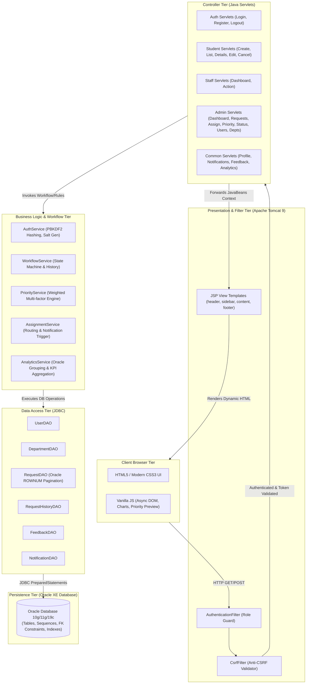
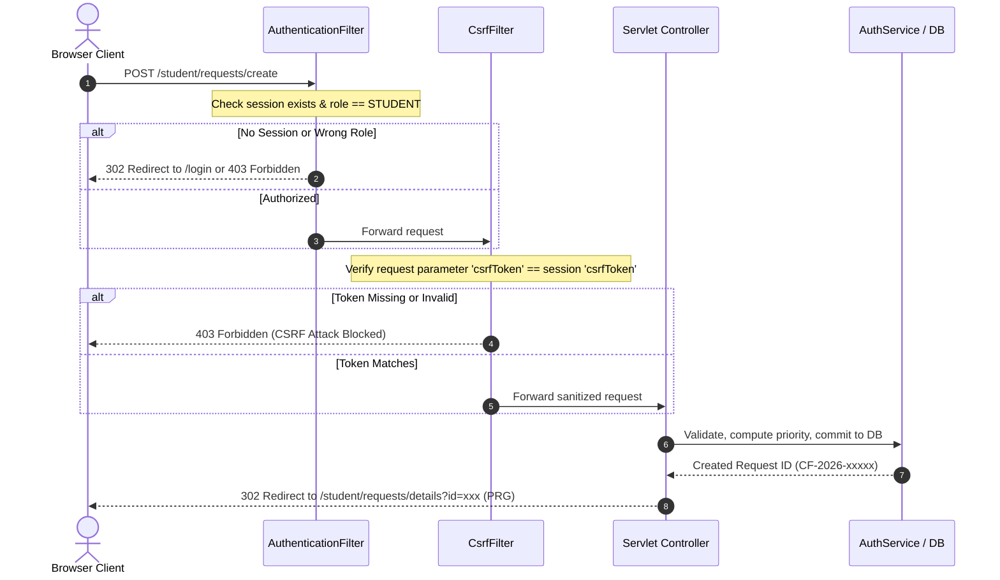

# CampusFlow — System Architecture & Design Specification

## 1. Executive Architectural Overview

**CampusFlow** is an enterprise-grade Smart College Service & Issue Management System developed strictly using a classical, robust Java EE Model-View-Controller (MVC) architecture backed by an Oracle Relational Database Management System.

The application adheres strictly to pure native technologies without external frameworks:
- **Presentation**: Pure HTML5, modern CSS3 (Custom Properties / Design Tokens), Vanilla JavaScript (ES6+), and JavaServer Pages (JSP 2.3).
- **Controllers & Routing**: Java Servlets (`javax.servlet` API, Tomcat 9.0 compatible).
- **Business Logic**: Pure Java Service classes enforcing state machines, rule-based priority scoring, role-based workflows, and validation.
- **Data Access**: Data Access Objects (DAOs) executing native Oracle SQL through standard Java Database Connectivity (`java.sql.PreparedStatement`).
- **Persistence**: Oracle Database 10g/11g/19c Enterprise/Express Edition.

---

## 2. Multi-Tier Architectural Topology

---

## 3. Tier Responsibilities

### 3.1 View & Presentation Layer
- **JSP Templates**: Dynamically render models passed via `HttpServletRequest` attributes. Built with modular fragments (`header.jsp`, `sidebar.jsp`, `footer.jsp`, `messages.jsp`).
- **Design System (`assets/css/main.css`)**: Pure CSS3 utilizing custom property tokens (`--primary-600`, `--neutral-800`, etc.), Flexbox, CSS Grid, and media queries for responsive mobile/tablet/desktop layouts.
- **Client Scripting (`assets/js/app.js` & `charts.js`)**:
  - Live Priority Score Calculator previewing priority based on urgency, impact, and location.
  - Native SVG chart generators rendering Donut and Progress Bar analytics directly in the DOM without external dependencies.
  - Asynchronous AJAX fetching of staff members filtered by selected department.
  - Accessible modal dialogs and confirmation boxes.

### 3.2 Controller Layer
- 23 dedicated `HttpServlet` subclasses configured in `WEB-INF/web.xml`.
- Enforces HTTP method restrictions (GET for idempotent views, POST for state changes).
- Implements the **Post/Redirect/Get (PRG)** design pattern: all state modifications (request creation, status update, user activation) redirect with flash messages in session to eliminate form resubmission anomalies on page refresh.

### 3.3 Business Logic & Workflow Layer
- **`PriorityService`**: Calculates dynamic priority levels (`LOW`, `MEDIUM`, `HIGH`, `CRITICAL`) using weighted multi-attribute algorithms:
  $$\text{Score} = (\text{Urgency} \times 3) + (\text{Impact} \times 2) + \text{LocationWeight}$$
  Auto-escalates safety hazards, water line bursts, electrical sparks, and infrastructure emergencies to `CRITICAL`.
- **`WorkflowService`**: Enforces the valid transition lifecycle:
  - `SUBMITTED` $\rightarrow$ `ASSIGNED` or `CANCELLED` (Student/Admin)
  - `ASSIGNED` $\rightarrow$ `IN_PROGRESS` or `CANCELLED`
  - `IN_PROGRESS` $\rightarrow$ `RESOLVED`
  - `RESOLVED` $\rightarrow$ `CLOSED`
  - Disallows illegal status jumps (e.g., jumping from `SUBMITTED` directly to `RESOLVED`).
  - Records every change in `REQUEST_HISTORY` with user attribution and timestamps.
- **`AuthService`**: Enforces PBKDF2 password derivation (65,536 iterations, SHA-256) with 16-byte cryptographic salts. Prevents timing attacks with constant-time equality comparisons.
- **`AnalyticsService`**: Executes live aggregate queries (`COUNT`, `AVG`, `GROUP BY`) across Oracle tables to calculate resolution rates, departmental workloads, average turnaround times, and rating averages.

### 3.4 Data Access Layer (DAO)
- Strictly utilizes `java.sql.PreparedStatement` to ensure immunity from SQL Injection.
- Uses Oracle sequences (`SEQ_USERS.NEXTVAL`, `SEQ_REQUESTS.NEXTVAL`, etc.) for deterministic ID generation.
- Implements Oracle-native `ROWNUM` subquery pagination for high-performance handling of enterprise request datasets.
- Manages transactional boundaries (`con.setAutoCommit(false)`, `con.commit()`, `con.rollback()`) for compound operations (e.g., status update + audit history insert + recipient notification).

---

## 4. Complete Controller & Route Catalog

| URL Pattern | Servlet Class | Supported Methods | Role Authorization | Purpose |
| :--- | :--- | :--- | :--- | :--- |
| `/` | `HomeServlet` | GET | Public | Landing page / system gateway |
| `/login` | `LoginServlet` | GET, POST | Public | User credential authentication |
| `/register` | `RegisterServlet` | GET, POST | Public | Student account registration |
| `/logout` | `LogoutServlet` | GET, POST | Authenticated | Session invalidation |
| `/profile` | `ProfileServlet` | GET, POST | Authenticated | User profile & password update |
| `/notifications` | `NotificationServlet` | GET, POST | Authenticated | Notification inbox & mark-as-read |
| `/student/dashboard` | `StudentDashboardServlet` | GET | `STUDENT` | Student KPI metrics & recent activity |
| `/student/requests/create` | `RequestCreateServlet` | GET, POST | `STUDENT` | Issue submission with priority engine |
| `/student/requests` | `RequestListServlet` | GET | `STUDENT` | Personal request history & filter |
| `/student/requests/details` | `RequestDetailsServlet` | GET | `STUDENT` | Detailed tracking timeline & remarks |
| `/student/requests/edit` | `RequestEditServlet` | GET, POST | `STUDENT` | Edit pending request before assignment |
| `/student/requests/cancel` | `RequestCancelServlet` | POST | `STUDENT` | Cancel pending request |
| `/student/feedback` | `FeedbackServlet` | GET, POST | `STUDENT` | 5-star rating & review submission |
| `/staff/dashboard` | `StaffDashboardServlet` | GET | `STAFF` | Assigned task queue & workload stats |
| `/staff/action` | `StaffActionServlet` | POST | `STAFF` | Progress update (Accept, In-Progress, Resolve) |
| `/admin/dashboard` | `AdminDashboardServlet` | GET | `ADMIN` | Central operational metrics & recent logs |
| `/admin/requests` | `AdminRequestListServlet` | GET | `ADMIN` | Enterprise request master search/filter |
| `/admin/requests/assign` | `AdminAssignmentServlet` | POST | `ADMIN` | Dispatch request to dept & staff |
| `/admin/requests/priority` | `AdminPriorityServlet` | POST | `ADMIN` | Admin override of priority score |
| `/admin/requests/status` | `AdminStatusServlet` | POST | `ADMIN` | Admin workflow status override |
| `/admin/departments` | `DepartmentServlet` | GET, POST | `ADMIN` | Department CRUD operations |
| `/admin/users` | `UserManagementServlet` | GET, POST | `ADMIN` | User directory & status toggle |
| `/admin/analytics` | `AnalyticsServlet` | GET | `ADMIN` | Departmental performance & KPI charts |

---

## 5. Security & Protection Subsystem

1. **Authentication Guard (`AuthenticationFilter`)**: Intercepts every protected path prefix (`/student/*`, `/staff/*`, `/admin/*`). Rejects unauthenticated users to `/login`. Rejects unauthorized cross-role attempts with HTTP 403 Forbidden.
2. **Anti-CSRF Defense (`CsrfFilter`)**: Generates a cryptographically strong 128-bit random token on session creation. Inspects all state-altering POST requests. If missing or mismatched, halts execution with HTTP 403.
3. **Password Security (`PasswordUtil`)**: Uses `PBKDF2WithHmacSHA256` key derivation with 65,536 iterations and unique 16-byte random salt per user. Stored as `iterations:hexSalt:hexHash`.
4. **XSS Defense (`SecurityUtil`)**: Escapes all user-supplied input strings before rendering using HTML entity replacement (`&`, `<`, `>`, `"`, `'`).
5. **Session Management**: Session fixation defense regenerates session IDs upon successful authentication. Sessions expire after 30 minutes of inactivity (`web.xml`). Calling `/logout` explicitly executes `session.invalidate()`.
