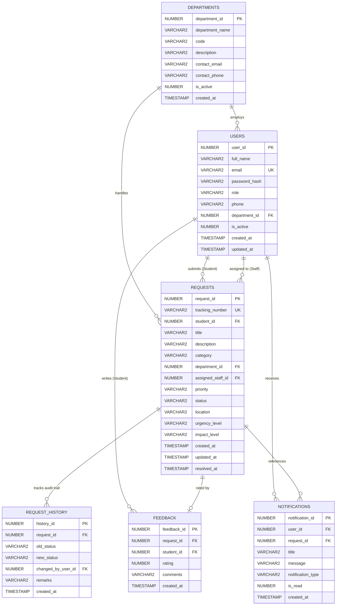

# CampusFlow — Oracle Database Schema & Design Specification

## 1. Relational Database Overview

**CampusFlow** relies on an enterprise Oracle Database (compatible with Oracle 10g XE, 11g XE, and 19c Enterprise) to guarantee ACID transaction guarantees, data durability, and referential integrity.

### Key Database Design Principles:
- **Strict Sequences & Synthetic Keys**: In Oracle 10g, auto-increment columns are supported via Oracle Sequences (`SEQ_*.NEXTVAL`).
- **Domain Constraints**: Status, priority, and role fields are enforced by Oracle `CHECK` constraints at the schema layer.
- **Relational Integrity**: Foreign key constraints prevent orphaned records; cascading deletes are scoped strictly to transient dependents (e.g., feedback or notifications).
- **Index Optimization**: B-Tree indexes on search keys, status filters, and foreign keys optimize high-volume queries and `ROWNUM` pagination.

---

## 2. Entity-Relationship Diagram (ERD)

---

## 3. Complete Data Dictionary

### 3.1 Table: `DEPARTMENTS`
Maintains the college's operational divisions responsible for issue resolution.

| Column | Data Type | Nullable | Default | Constraints / Description |
| :--- | :--- | :--- | :--- | :--- |
| `DEPARTMENT_ID` | `NUMBER(10)` | NO | `SEQ_DEPARTMENTS.NEXTVAL` | Primary Key |
| `DEPARTMENT_NAME` | `VARCHAR2(100)` | NO | - | Unique department name |
| `CODE` | `VARCHAR2(20)` | NO | - | Unique short code (e.g., `IT`, `MAINT`) |
| `DESCRIPTION` | `VARCHAR2(500)` | YES | - | Scope of department responsibilities |
| `CONTACT_EMAIL` | `VARCHAR2(150)` | YES | - | Official department liaison email |
| `CONTACT_PHONE` | `VARCHAR2(30)` | YES | - | Extension or contact phone |
| `IS_ACTIVE` | `NUMBER(1)` | NO | `1` | `CHECK (IS_ACTIVE IN (0, 1))` |
| `CREATED_AT` | `TIMESTAMP` | NO | `CURRENT_TIMESTAMP` | Record creation audit timestamp |

### 3.2 Table: `USERS`
Stores account credentials, profile attributes, and roles for Students, Staff, and Administrators.

| Column | Data Type | Nullable | Default | Constraints / Description |
| :--- | :--- | :--- | :--- | :--- |
| `USER_ID` | `NUMBER(10)` | NO | `SEQ_USERS.NEXTVAL` | Primary Key |
| `FULL_NAME` | `VARCHAR2(100)` | NO | - | User's full name |
| `EMAIL` | `VARCHAR2(150)` | NO | - | Unique login email address |
| `PASSWORD_HASH` | `VARCHAR2(256)` | NO | - | PBKDF2 salted hash (`iters:salt:hash`) |
| `ROLE` | `VARCHAR2(20)` | NO | - | `CHECK (ROLE IN ('STUDENT', 'STAFF', 'ADMIN'))` |
| `PHONE` | `VARCHAR2(30)` | YES | - | Contact phone number |
| `DEPARTMENT_ID` | `NUMBER(10)` | YES | NULL | Foreign Key referencing `DEPARTMENTS(DEPARTMENT_ID)` |
| `IS_ACTIVE` | `NUMBER(1)` | NO | `1` | `CHECK (IS_ACTIVE IN (0, 1))` (1=Active, 0=Deactivated) |
| `CREATED_AT` | `TIMESTAMP` | NO | `CURRENT_TIMESTAMP` | Account creation timestamp |
| `UPDATED_AT` | `TIMESTAMP` | NO | `CURRENT_TIMESTAMP` | Last profile update timestamp |

### 3.3 Table: `REQUESTS`
Core entity storing all student service requests, issue classification, priority, and assignment status.

| Column | Data Type | Nullable | Default | Constraints / Description |
| :--- | :--- | :--- | :--- | :--- |
| `REQUEST_ID` | `NUMBER(10)` | NO | `SEQ_REQUESTS.NEXTVAL` | Primary Key |
| `TRACKING_NUMBER` | `VARCHAR2(30)` | NO | - | Unique tracking code (`CF-2026-XXXXX`) |
| `STUDENT_ID` | `NUMBER(10)` | NO | - | Foreign Key $\rightarrow$ `USERS(USER_ID)` |
| `TITLE` | `VARCHAR2(200)` | NO | - | Brief issue summary |
| `DESCRIPTION` | `VARCHAR2(4000)` | NO | - | Complete problem narrative |
| `CATEGORY` | `VARCHAR2(50)` | NO | - | Functional category (e.g., IT Support) |
| `DEPARTMENT_ID` | `NUMBER(10)` | YES | NULL | Foreign Key $\rightarrow$ `DEPARTMENTS(DEPARTMENT_ID)` |
| `ASSIGNED_STAFF_ID`| `NUMBER(10)` | YES | NULL | Foreign Key $\rightarrow$ `USERS(USER_ID)` |
| `PRIORITY` | `VARCHAR2(20)` | NO | `'MEDIUM'` | `CHECK (PRIORITY IN ('LOW','MEDIUM','HIGH','CRITICAL'))` |
| `STATUS` | `VARCHAR2(20)` | NO | `'SUBMITTED'` | `CHECK (STATUS IN ('SUBMITTED','ASSIGNED','IN_PROGRESS','RESOLVED','CLOSED','CANCELLED'))` |
| `LOCATION` | `VARCHAR2(200)` | NO | - | Campus location (e.g., Block A, Room 302) |
| `URGENCY_LEVEL` | `VARCHAR2(20)` | NO | `'MEDIUM'` | `CHECK (URGENCY_LEVEL IN ('LOW','MEDIUM','HIGH','EMERGENCY'))` |
| `IMPACT_LEVEL` | `VARCHAR2(20)` | NO | `'SINGLE_USER'`| `CHECK (IMPACT_LEVEL IN ('SINGLE_USER','ROOM','FLOOR','BUILDING_WIDE'))` |
| `CREATED_AT` | `TIMESTAMP` | NO | `CURRENT_TIMESTAMP` | Submission timestamp |
| `UPDATED_AT` | `TIMESTAMP` | NO | `CURRENT_TIMESTAMP` | Last modification timestamp |
| `RESOLVED_AT` | `TIMESTAMP` | YES | NULL | Resolution completion timestamp |

### 3.4 Table: `REQUEST_HISTORY`
Immutable audit trail capturing all status transitions, assignments, and remarks.

| Column | Data Type | Nullable | Default | Constraints / Description |
| :--- | :--- | :--- | :--- | :--- |
| `HISTORY_ID` | `NUMBER(10)` | NO | `SEQ_REQUEST_HISTORY.NEXTVAL` | Primary Key |
| `REQUEST_ID` | `NUMBER(10)` | NO | - | Foreign Key $\rightarrow$ `REQUESTS(REQUEST_ID)` |
| `OLD_STATUS` | `VARCHAR2(20)` | YES | NULL | Previous state |
| `NEW_STATUS` | `VARCHAR2(20)` | NO | - | New state |
| `CHANGED_BY_USER_ID`| `NUMBER(10)` | NO | - | Foreign Key $\rightarrow$ `USERS(USER_ID)` |
| `REMARKS` | `VARCHAR2(1000)`| YES | NULL | Action notes / progress remarks |
| `CREATED_AT` | `TIMESTAMP` | NO | `CURRENT_TIMESTAMP` | Action timestamp |

### 3.5 Table: `FEEDBACK`
Post-resolution feedback and 5-star student ratings.

| Column | Data Type | Nullable | Default | Constraints / Description |
| :--- | :--- | :--- | :--- | :--- |
| `FEEDBACK_ID` | `NUMBER(10)` | NO | `SEQ_FEEDBACK.NEXTVAL` | Primary Key |
| `REQUEST_ID` | `NUMBER(10)` | NO | - | Foreign Key $\rightarrow$ `REQUESTS(REQUEST_ID)` |
| `STUDENT_ID` | `NUMBER(10)` | NO | - | Foreign Key $\rightarrow$ `USERS(USER_ID)` |
| `RATING` | `NUMBER(1)` | NO | - | `CHECK (RATING BETWEEN 1 AND 5)` |
| `COMMENTS` | `VARCHAR2(1000)`| YES | NULL | Student narrative review |
| `CREATED_AT` | `TIMESTAMP` | NO | `CURRENT_TIMESTAMP` | Submission timestamp |

*Constraint*: `UNIQUE (REQUEST_ID, STUDENT_ID)` enforces single feedback per ticket.

### 3.6 Table: `NOTIFICATIONS`
Internal in-app notifications dispatched on workflow events.

| Column | Data Type | Nullable | Default | Constraints / Description |
| :--- | :--- | :--- | :--- | :--- |
| `NOTIFICATION_ID`| `NUMBER(10)` | NO | `SEQ_NOTIFICATIONS.NEXTVAL` | Primary Key |
| `USER_ID` | `NUMBER(10)` | NO | - | Recipient Foreign Key $\rightarrow$ `USERS(USER_ID)` |
| `REQUEST_ID` | `NUMBER(10)` | YES | NULL | Foreign Key $\rightarrow$ `REQUESTS(REQUEST_ID)` |
| `TITLE` | `VARCHAR2(150)` | NO | - | Short notification headline |
| `MESSAGE` | `VARCHAR2(1000)`| NO | - | Notification text |
| `NOTIFICATION_TYPE`| `VARCHAR2(30)`| NO | `'INFO'` | Category (`STATUS_CHANGE`, `ASSIGNMENT`, `NEW_REQUEST`) |
| `IS_READ` | `NUMBER(1)` | NO | `0` | `CHECK (IS_READ IN (0, 1))` (0=Unread, 1=Read) |
| `CREATED_AT` | `TIMESTAMP` | NO | `CURRENT_TIMESTAMP` | Dispatch timestamp |

---

## 4. Indexing Strategy & Performance Justification

The following secondary indexes were created in `04_indexes.sql` to optimize query performance across high-volume operational tables:

| Index Name | Table | Indexed Columns | Justification / Usage |
| :--- | :--- | :--- | :--- |
| `IDX_REQ_STUDENT` | `REQUESTS` | `STUDENT_ID` | Speeds up Student dashboard and "My Requests" list queries |
| `IDX_REQ_STAFF` | `REQUESTS` | `ASSIGNED_STAFF_ID` | Speeds up Staff assigned work queue |
| `IDX_REQ_STATUS` | `REQUESTS` | `STATUS` | Filters by status (Active, Resolved, Pending) |
| `IDX_REQ_DEPT` | `REQUESTS` | `DEPARTMENT_ID` | Aggregates requests by department for analytics |
| `IDX_REQ_CREATED` | `REQUESTS` | `CREATED_AT DESC` | Powers chronological sorting & pagination subqueries |
| `IDX_HIST_REQ` | `REQUEST_HISTORY` | `REQUEST_ID` | Accelerates fetching complete timeline on ticket details page |
| `IDX_NOTIF_USER` | `NOTIFICATIONS` | `USER_ID, IS_READ` | Speeds up unread notification badge count in navbar |
| `IDX_USERS_EMAIL` | `USERS` | `EMAIL` | Accelerates user authentication lookups |
| `IDX_USERS_DEPT` | `USERS` | `DEPARTMENT_ID` | Speeds up staff lookup when populating assignment dropdowns |

---

## 5. SQL Script Artifacts Catalog

1. **`01_create_schema.sql`**: Complete DDL creating the 6 tables, sequences, foreign keys, and check constraints.
2. **`02_seed_departments.sql`**: Seeds the 8 core university departments.
3. **`03_create_admin_instructions.sql`**: Seeds bootstrap administrator, staff, and student accounts with verified PBKDF2 hashes.
4. **`04_indexes.sql`**: Defines all performance and foreign key indexes.
5. **`05_development_reset.sql`**: Drops all constraints, tables, and sequences in reverse dependency order for clean reinstalls.
